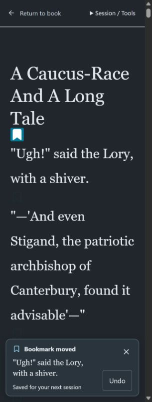

# Flow Listening 2.3.1

Release version: **2.3.1** — a patch to **Flow Listening 2.3**.

**App:** https://flow-listening-v2.vercel.app/

**Release:** https://github.com/asynchronousstate/flow/releases/tag/v2.3.1

**Source:** https://github.com/asynchronousstate/flow/tree/v2.3.1

Selecting another paragraph now moves the Bookmark immediately, even while an
earlier selection is being saved or its toast is visible. Undo is an optional
recovery action rather than a prerequisite for the next selection. The approved
design removes the persistent bottom Bookmark / next-start status strip and
keeps the toast, paragraph preview, Undo and Dismiss.

## Behavior

- Every changed selection refreshes the toast and its preview. Other paragraph
  icons and the Session / Tools list remain tappable during saving.
- Accepted actions are saved in order. An earlier completion cannot move the
  visible selection away from a newer tap. A → B → C leaves C selected; Undo
  restores B when those saves succeed, including when Undo is pressed before
  the queue has finished.
- Undo uses the actual preceding plan captured by the save transaction. Its
  existing revision check protects another window's newer range, Bookmark or
  appearance changes. A failed operation reconciles the selection with the last
  confirmed or recovered saved state.
- A successful toast has an eight-second visibility window, paused during
  saving, hover or keyboard focus. A new operation refreshes it. Errors remain
  visible until dismissed or another operation is accepted. Dismiss hides the
  toast without changing the Bookmark.
- Tapping the selected icon is idempotent; it does not clear the Bookmark.
- Normal **Return to book** waits for accepted Bookmark operations before
  reopening listening setup. The queue can continue after a component unmount
  while its JavaScript context survives; this is not a process-death or native
  tab-close durability guarantee.

## Preserved workflow

Settings still displays **Flow Listening 2.3**. The production origin and PWA
identity remain the same, and the existing `v2.3.0` release is retained.

From / Through still use EPUB Contents chapters. Fresh listening setup defaults
to a valid saved Bookmark and shows its read-only excerpt. The current prepared
session remains a snapshot: saving or undoing changes the next start without
replacing its narration article or altering paragraph spacing. A fresh Listen
launch uses the saved start; reloading an existing session URL retains that
session's original prose.

The approved paragraph icons retain 6% idle opacity, a transparent idle box,
one-em size and fully opaque white selection on teal. Bookmark feedback remains
outside the narration article. No persistent next-start / saved strip remains
at the bottom of the document.

## Validation

**58 targeted regression groups passed:**

- `scripts/test-bookmark-queue.cjs`: **17** ordering and recovery groups,
  including rapid selection, Undo while saving, a new selection during Undo,
  failures, another window's changes, disposal and a stable queue drain.
- `scripts/test-integrated-listening-store.cjs`: **24** storage groups,
  including source checks, revision-safe Undo, chapter endpoints and immutable
  launch records. Its structured-clone memory database is not real IndexedDB.
- `scripts/test-listening-plan.cjs`: **17** plan reconciliation groups,
  including fresh Bookmark defaults and explicit start-choice preservation.

The 138-group result documented for the original
[2.3.0 release](flow-listening-v2.3-testing.md) is historical; the full aggregate
has not been rerun as part of this patch's recorded results above.

Reader and website lint passed. The standalone companion PWA also built; it is
separate from the integrated reader deployed at the production address.

Aggregate workspace build and lint were rerun and still do not pass on this
Windows environment. The unchanged vendored EPUBJS scripts use POSIX
`NODE_ENV=production` assignment and a literal `src; exit 0` shell fragment.
The aggregate build also encounters an existing marketing-homepage prerender
TypeError for `en-US`, `ja-JP` and `zh-CN`. These failures are outside the
Bookmark patch; they are not reported as successful workspace checks.

Reader production build passed lint, TypeScript, optimized compilation and all
30 localized pages.

The built app was checked in the in-app Chromium browser using real IndexedDB:

- Consecutive Alice paragraph selections updated one active Bookmark with no
  disabled icons. Undo restored the preceding paragraph. Narration article HTML,
  geometry and scroll position remained identical during save / Undo.
- Dismiss followed by another selection displayed a fresh preview toast, which
  subsequently auto-dismissed while retaining the selected Bookmark.
- Return to book retained the III–IV range and the latest saved excerpt. A
  fresh launch began with “\"Ugh!\" said the Lory, with a shiver.” and retained
  both selected chapters; earlier prose was omitted.
- A real second-window save caused stale Undo to be rejected. The newer
  Bookmark was kept and reflected in the first window with an explanatory error.
- At a 320px viewport with 28px Large / Dark prose there was no horizontal
  overflow. The toast measured about 120px high, below the static 220px article
  tail space. The bottom status strip was absent; idle / selected icon opacity
  remained 0.06 / 1.

The GitHub release records the published commit, production deployment and live
verification. These browser checks do not substitute for native Edge speech.

This patch does not establish native Android Edge narration, chapter-boundary
speech, physical-device installation, process-death recovery, background or
screen-lock playback. Earlier desktop Gunboat speech evidence and Android
Chrome UI checks remain separate results.
